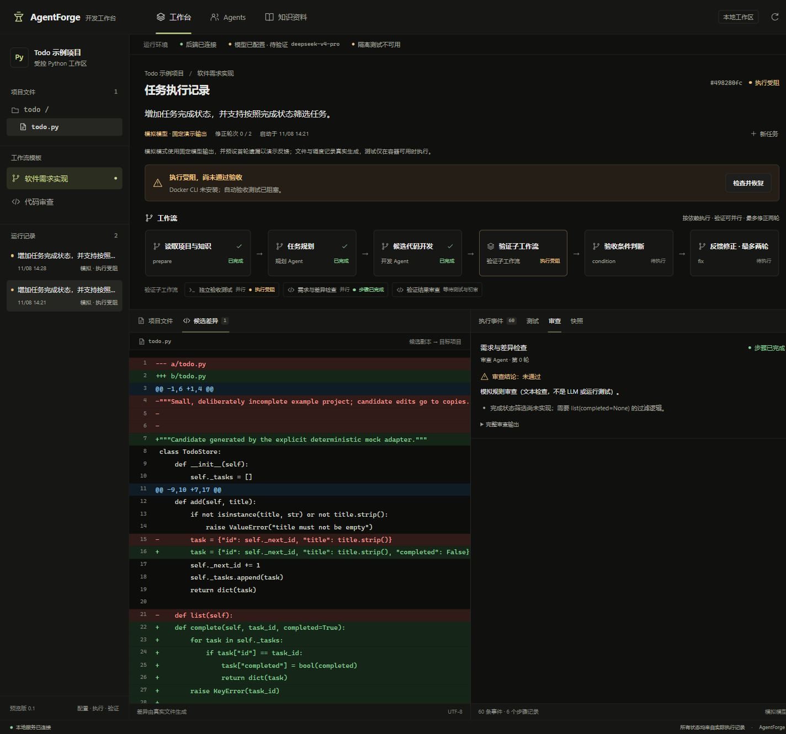
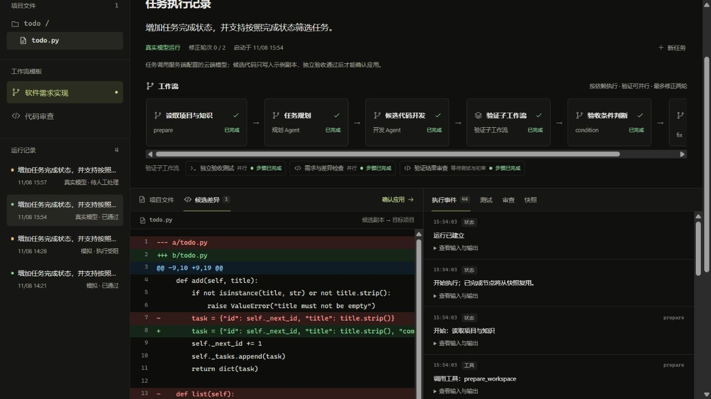
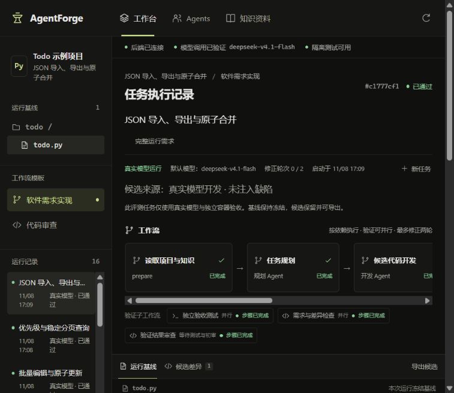
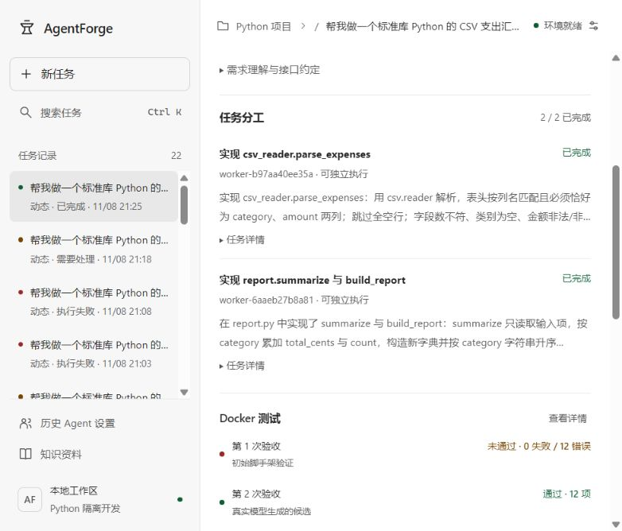
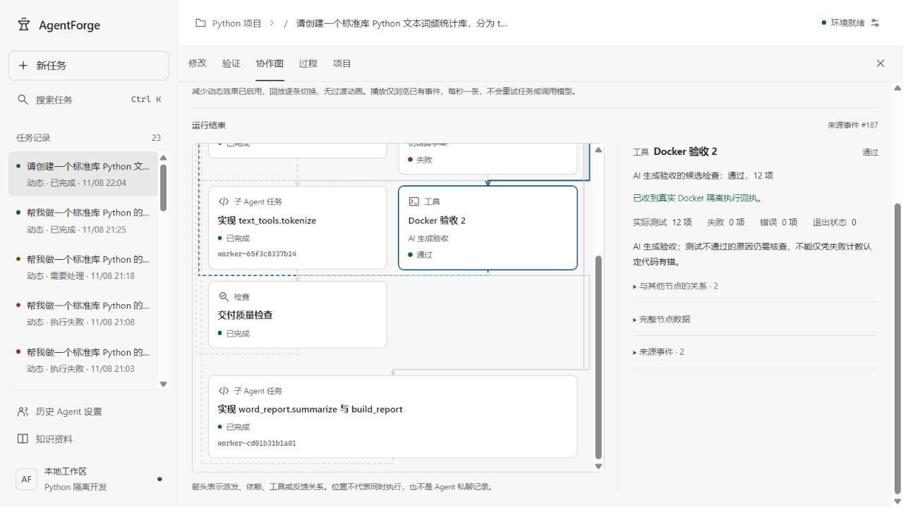
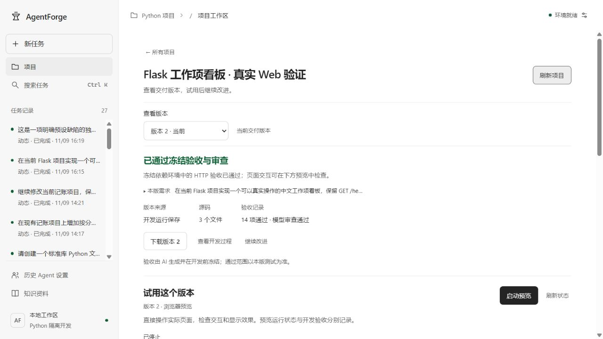
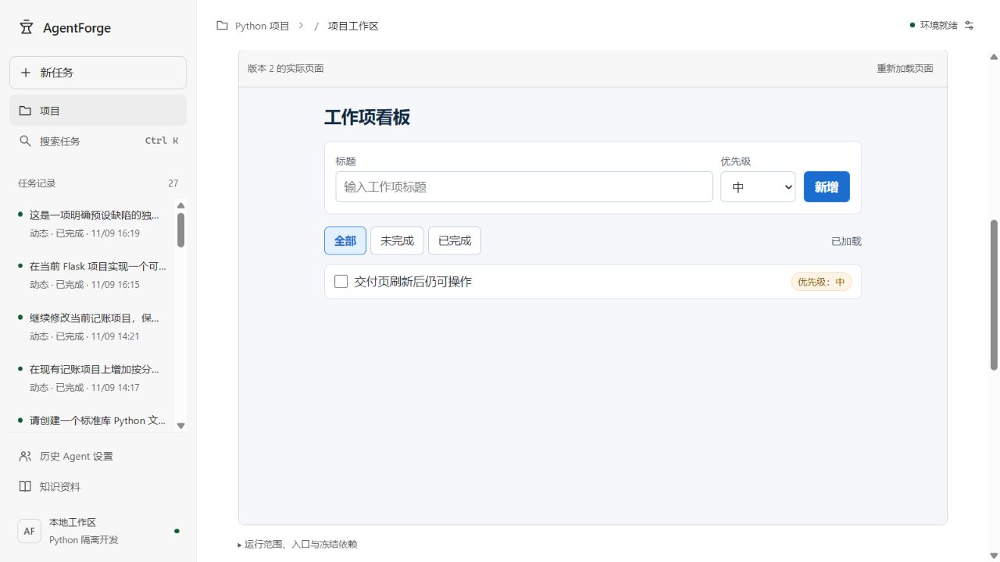

# AgentForge 多智能体编排与软件开发工作台

## 0 封面信息

- **赛题**：赛题一「Agent 编排创新应用」　**项目**：AgentForge 多智能体编排与软件开发工作台
- **队伍**：奶龙队　**项目负责人**：王拙诚　**学校**：湖北工业大学工程技术学院　**成员**：王拙诚、吴捍卫、黄浩　**指导教师**：刘浪
- **提交命名**：赛题一+奶龙队+AgentForge（官方队伍编号：2117173210695860225）
- **版本日期**：初赛提交版 v1.0，2026-11-12（初赛截止 2026-11-20）
- **运行形态**：本机 Web 工作台（React 19 + TypeScript 7 + Vite 8；FastAPI + SQLite；Python 3.13），候选代码只在 WSL2 内 Docker 执行；模型 deepseek-v4.1-flash（智云 API）

**一句话**：AgentForge 由模型动态拆任务、按依赖与写入范围并行派发，用独立 Docker 验收与语义审查做完成门控，并把调度依据、失败反馈、修正过程全部留成可回放事件——结论可追溯到原始回执，而不是模型自述。

## 1 选题背景与场景需求分析

单个 Agent 承担长任务会遇到上下文膨胀、角色混叠、失败不可归因三个问题；多 Agent 协作把任务交给上下文隔离的执行者，是自然解法，赛题也把 LobeHub、DeepSeek Harness 作为对标。真正的难点不是“多个 Agent 轮流说话”，而是：编排由任务本身决定而非提前写死；结果经过独立验证而非模型自称成功；失败形成结构化反馈并驱动有限、可控的迭代。不少同类作品停在“固定流水线 + 模型自述验收”，无法回答“凭什么相信这次通过”。

场景需求集中在三类用户：**高校课程与实训**需要可私有化、可解释、可复现的教学平台，学生能看到任务图、调度依据、Docker 回执与失败原因；**科研小工具**（数据脚本、CLI、小型 Web 页）边界清晰、验收可自动化，适合 Agent 快速实现并留证据链；**企业研发提效**要求模型可替换、源码不出内网、执行受控、失败不静默降级。共同需求六点：本地化与密钥不外泄、多 Agent 动态协作、结果可信、失败可解释可迭代、运行可回放可复现、模型与工具可替换。

选择软件开发作为首个场景，是因为验收可机器判定（独立单测、HTTP 测试、容器退出码），能把“编排是否有效”与“模型口才”分开评估；平台主体是通用编排器，替换 Agent、工具与工作流即可迁移。初赛取舍：把一条真实闭环做深，不宣称通用软件工程能力，也不宣称普遍效率提升。**核心优势**可概括为三点：模型驱动的动态编排而非硬编码流水线；独立验收与哈希绑定使结果可验证；事件、快照与复现包使运行可审计、可复现。

典型使用流程（以课程实训为例）：教师导入示例项目与需求，学生在界面输入任务；平台冻结验收并动态派发，学生查看协作图与失败反馈；教师用导出的事件与哈希作为评分依据。这条流程已在 Flask 看板和记账 CLI 两个案例上真实走通。需求边界：平台当前只接受有界标准库 Python 多文件项目、JSON 可传递的函数接口，以及固定 wheel 依赖的 Python Web 项目；任意大型仓库、自动安装任意依赖、常驻生产服务不在初赛范围。

## 2 平台总体架构设计与技术选型

### 2.1 分层架构

平台分六层，自下而上所有执行事实由宿主记录，模型只能提出动作。

```text
[交互层] React 19 / TypeScript 7 / Vite 8（对话、项目、协作图、交付页）
    | HTTP /api（40 条路由）
    v
[API 层] FastAPI + SQLite（5 库、16 种表结构）
    | 运行、事件、步骤、快照、版本、验收回执
    v
[编排内核] 主 Agent 决策 -> 动态任务图 -> 调度 -> 门控 -> 预算收尾
    | 派发任务 / 调用工具
    v
[执行与工具层] 模型适配、知识检索、文件编辑、项目/Web 工具
    | 候选源码
    v
[隔离验收层] WSL2 内 Docker Engine（禁网、只读、非 root、限额）
    | 验收回执、候选哈希
    v
[证据层] 事件、快照、候选哈希、验收回执、独立审查、ZIP 复现包
```

一次自主运行：提交需求 → 主 Agent 拟定并冻结验收 → 模型 `dispatch` 建任务（名称、指令、依赖、写入范围）→ 宿主校验依赖、环、写入冲突与预算后并行执行 → 每批结束交还控制权 → 候选哈希绑定 Docker 验收 → 语义审查 → `finish` 门控。

**证据优先**：每次工具调用、候选写入、容器执行与审查结论都先写事件再更新状态；成功节点与恢复上下文在同一事务提交，避免“节点成功但输出丢失”。

### 2.2 技术选型

| 层 | 选型 | 理由 | 边界 |
|---|---|---|---|
| 前端 | React 19 + TS 7 + Vite 8，19 文件 3,268 行 | 事件驱动详情、协作图、时间轴回放需强类型状态 | 无路由框架 |
| 后端 | FastAPI + Python 3.13，21 模块 6,958 行、40 API | 异步接口、校验、OpenAPI | 单机单进程，无多用户认证 |
| 存储 | SQLite 5 库、16 种表结构 | 事务、不可变版本、零运维、整库快照取证 | 无分布式 |
| 隔离 | WSL2 内 Docker Engine + Python 3.13 镜像 | 候选不在宿主机执行，可限网络、权限、资源 | WSL 单点；父子同 UID |
| 模型 | deepseek-v4.1-flash（智云 API） | 支持工具调用与 JSON 输出，成本适合多轮实验 | 429、格式错误、未知用量均有记录 |
| 知识 | `knowledge/*.md` 关键词检索 | 轻量可解释，无需向量设施 | 非向量库，最多 3 条片段 |

### 2.3 开源使用与自定义改进

使用 React、Vite、TypeScript、FastAPI、Uvicorn、SQLite 等开源组件（许可证见 `docs/third-party.md`）。编排层**未套用 LangChain、AutoGen 等框架**：本平台要把每次调度、每个工具结果、每份候选哈希写成可验证事件，要在同一内核实现模型驱动与模板两条路径，且完成门控要求“模型提议、宿主裁决”。相对通用框架的自定义改进：能力与工具权限双重筛选、低负载优先与专用 Agent 排序、失败重派、验证子工作流并行、候选哈希失效、SQLite 原子节点检查点、配置版本快照、收尾预算预留。

### 2.4 赛题要求覆盖

| 要求 | 对应实现 | 章节 |
|---|---|---|
| ① 五核心模块 | Agent 定义配置、工作流编排、调度执行、验证监控、反馈优化 | 2–6 |
| ② 可运行原型 | 工作台 + 40 API + 真实模型 + 真实 Docker + 复现包 | 6、7、附录 A |
| ③ 多 Agent 协作 | 主 Agent 动态派发，子 Agent 上下文隔离、并行、可回放 | 3、4 |
| ④ 自我循环 | 执行→验收→反馈→修正→复验；依据真实失败补派任务 | 4.4 |
| ⑤ LLM 推理核心 | 拆分、指令、编码、验收生成、语义审查均由模型完成 | 3、8 |
| ⑥ 智能调度 | 任务图由模型决定，宿主只强制依赖、权限、写入互斥、并发、预算 | 4.1–4.3 |
| ⑦ 工具/RAG/记忆 | Function Calling 工具、本地 RAG、任务级记忆；MCP/A2A 未接入 | 3.4、8 |
| ⑧ 开源自定义改进 | 见 2.3，依赖与原创边界见 `docs/third-party.md` | 2.3 |

这张表同时是自查清单：①–⑥ 均有可运行实现与真实运行证据；⑦ 只实现了 Function Calling 与本地 RAG，MCP/A2A 与向量库如实标为未完成；⑧ 的第三方依赖与原创边界逐项记录，不把开源组件包装成原创工作。

## 3 Agent 角色定义、工作流设计与编排逻辑

### 3.1 Agent 定义与团队

每个 Agent 由名称、角色、能力标签、允许工具、提示词、模型和启用状态定义；能力标签限定 `plan/develop/test/review/fix`，工具名由后端白名单校验。每次保存产生新版本，历史运行固定使用当时版本；运行开始时把 Agent 配置、工作流定义、知识版本冻结进快照。Agent 团队即一次运行中启用的 Agent 集合：模板路径按节点能力从团队中选择执行者，自主路径由主 Agent 按需创建子任务，不强制五个角色全部出场。

| 角色 | 能力 | 允许工具 | 职责 |
|---|---|---|---|
| 主 Agent | 自由描述 | 派发/取消/验证/结束控制动作 | 读需求与反馈，决定下一步并生成子任务 |
| 规划 | plan | read_project、knowledge_search | 分析需求与结构，拆分任务 |
| 开发 | develop | read_project、candidate_diff | 生成候选源码与差异 |
| 测试 | test | run_acceptance、read_project | 读取容器验收结果并解释 |
| 审查 | review | read_project、knowledge_search | 对照需求检查覆盖与风险，给出 `passed` |
| 修正 | fix | read_project、candidate_diff | 依据真实失败反馈修正候选 |

### 3.2 三条执行路径

| 路径 | 任务图来源 | 执行方式 | 验证 |
|---|---|---|---|
| legacy 模板 DAG | 代码定义的开发/审查模板 | 顺序、并行、条件、循环、子工作流，最多 2 轮修正 | 验收子工作流 + 汇总审查 + 门控 |
| autonomous（主入口） | 模型运行中动态生成 | 任意任务、依赖、写入范围，就绪任务并行 | 冻结 Docker 验收 + 语义审查 + `finish` 门控 |
| 项目 / Web 项目模式 | 主 Agent 直接编辑或派发 | 不可变版本、回归验收继承；Web 锁 wheel、离线镜像、iframe 预览 | 全量回归 + 审查 + 用户确认应用 |

真实例子：Web 看板需求在运行中被拆成 `impl-backend-api` 与 `impl-frontend` 两个无依赖任务，写入范围分别为 `app.py` 与 `static/`，因此同批并行；记账项目则由主 Agent 直接编辑 `ledger.py` 与 `main.py`，说明团队规模由任务决定，而不是按角色硬凑。

### 3.3 自主编排逻辑

1. **需求与冻结**：主 Agent 阅读需求、源码与已有验收，拟定并冻结本轮验收；子 Agent 无权修改验收。
2. **动态拆任务**：模型 `dispatch` 任意命名任务并给出指令、依赖、写入范围；宿主校验 ID 唯一、依赖存在且无环、写入范围合法。
3. **并行执行**：依赖已成功且写入路径不重叠的任务同批并发（上限 3），每个任务有独立子 Agent 上下文。
4. **交还控制权**：每批结束主 Agent 读取真实结果，选择 `continue`、`dispatch`（补派/替换）、`cancel`、`verify` 或 `finish`。
5. **验证与审查**：验收在禁网、只读、非 root、capabilities 丢弃、限额容器中运行，通过后由审查 Agent 做语义审查。
6. **完成门控**：`finish` 只是提议，宿主检查候选哈希已通过隔离验收、无待执行任务、审查通过才结束。

规则上，所有子任务共享同一份冻结验收；子 Agent 不能修改验收、不能扩大自己的工具权限，也不能读取其他任务的完整上下文。

### 3.4 知识库定义与集成、协作图与记忆

平台不展示“思维链”，而把事件投影成协作图：节点代表任务、工具调用、Docker 回执或审查结论，连线代表派发、依赖与反馈；点击节点可看分工、指令、涉及文件与真实回执，时间轴支持逐步、播放、暂停和回到实时，回放只读事件、不调用模型。知识库由 `knowledge/` 下 UTF-8 Markdown 定义（当前含开发规范、需求说明、测试说明），按英文词与中文字符匹配计分，返回最多 3 条片段及文件路径进入 Agent 上下文，模型也可经授权的 `knowledge_search` 再检索；项目模式把资料冻结为版本后再检索。须如实说明：这是本地关键词检索，**不是向量数据库或 embedding RAG**；记忆是任务级记忆（冻结上下文、事件、快照），不是跨任务长期自主学习。项目模式中，“记账项目约定”资料 v1 的版本 hash 与检索节选真实进入模型请求，事件记录 `knowledge_retrieved`；修改配置或资料后需新建运行才会生效。

## 4 调度算法与自我循环机制

### 4.1 模板工作流调度

```text
ready = 依赖均已成功持久化的节点；未知依赖或成环 -> 明确失败
按 (优先级降序, 节点 ID 升序) 取就绪节点
候选 = enabled 且具备所需能力与全部必需工具权限的 Agent
排序 = (当前负载升序, 能力标签数升序, Agent ID 升序)
分配给首个候选，负载 +1；结束/失败/取消时释放
失败 -> 排除该 Agent，最多再尝试 1 个其他匹配 Agent
无候选/超时/结构化输出无效 -> 明确错误；全部依据写入事件
```

能力标签数平局依据只表示“职责更专用”，不代表已验证的模型质量；当前负载是单进程计数，没有抢占、成本最优化或训练得到的策略。失败重派只允许换一个匹配 Agent，避免同一错误在多个 Agent 上无限重试；排除原因与候选列表全部落事件，便于复盘。

### 4.2 自主编排的动态调度

```text
主 Agent 输出 dispatch/continue/verify/finish/stop
宿主校验：ID 唯一、依赖存在且无环、写入范围合法、预算足够
batch = 依赖全部成功 且 写入路径两两互斥 的就绪任务（<=3）
并行执行 batch，逐任务记录起止、工具回执与候选哈希
batch 结束 -> 真实结果交还主 Agent 决定下一步
候选一经修改 -> 旧验收立即失效，必须重新 verify
```

与模板路径的关键差别：节点由模型根据需求、上一批结果和真实验收反馈生成；宿主只强制不能交给模型的约束（权限、依赖、写入互斥、并发、预算、完成判据）。这就是“智能化而非硬编码”的落点。真实决策链中，报表任务遇到 HTTP 429 后，主 Agent 创建了新 ID 的替代任务而不是静默重跑旧任务，最终整体通过；失败与替代关系都保留在事件里。

### 4.3 模型决定与宿主强制的边界

| 模型决定 | 宿主强制 |
|---|---|
| 任务拆分、名称、指令、依赖建议、写入范围 | ID 唯一、依赖存在且无环、路径白名单 |
| 是否补派/替换/取消、何时验证、是否结束 | 写入互斥、并发上限、步数/时间/调用/token 预算、验收冻结、哈希绑定与完成门控 |

### 4.4 自我循环

自我循环分两层。**模板路径**：执行→验收→反馈→修正→复验，最多 2 轮；测试与初审真实并发，再汇总审查，门控选择结束、修正或转人工。**自主编排**：主 Agent 读取真实 Docker 失败与审查意见，自行创建修复任务、替换失败任务或收尾；失败任务不静默重跑，但可创建新 ID 的替代任务。

| 阶段 | 输入 | 动作 | 终止 |
|---|---|---|---|
| 执行 | 任务图与候选 | 子 Agent 生成候选或工具执行 | 全部结束/失败/预算耗尽 |
| 验收 | 冻结验收 + 候选哈希 | 容器内独立测试 | 完整通过/失败回执 |
| 反馈 | stdout/stderr、失败项 | 分类为代码/协议/环境 | 写入事件并进入上下文 |
| 修正 | 真实失败反馈 | 修正 Agent 或新任务生成新候选 | 候选哈希变化 |
| 复验 | 新候选 | 重跑冻结验收 | 通过、轮次用尽或转人工 |

**收尾预算（finishing-budget-v1）**：新运行在原有总预算内为最终验收与审查预留最多 2 次调用、总 token 的 20%（≤65,536）、1 次验收、1 个决策步骤、总时间的 20%（≤60 秒），调用预留不超过总数 1/4；接近阈值时记录事件并进入收尾，停止委派、改文件与调用应用工具，但不扩大预算或跳过检查。旧运行沿用原路径，历史结果不回填。运行同时受 24 个决策步、32 项任务、8 次验收、900 秒等上限约束，任一触顶即进入收尾或待处理，不会无限循环。

### 4.5 失败分类与保留

失败拆成可区分类别分别留证：自然代码失败、JSON 协议/格式失败与格式重试、HTTP 429 等服务错误、预算拒绝、容器阻塞、导入基线未实现。格式重试不计为代码修正，429 不计为代码失败，导入基线失败不归因于模型。须如实说明：**现有自然代码失败后自动修正的样本仍然缺失**，已验证的修正闭环来自明确标注的预设缺陷实验，不等于自然开发中的自修复成功率。

## 5 结果验证策略与反馈优化逻辑

### 5.1 验证原则

只有与模型无关的外部证据才算通过。模型写 `test: passed`、伪造 `tool_calls` 或自称完成都不改变宿主记录；成功同时要求运行器报告测试通过、隔离成立、退出码为零、审查 `passed` 为真，且候选哈希与验收时一致。

### 5.2 隔离验收链

候选只在容器执行：关闭网络、只读根文件系统与代码/验收挂载、非 root、丢弃 capabilities、限制内存/CPU/进程，外层超时后清理。可信测试驱动在父进程，候选由独立 worker 子进程经受限 JSON 协议提供行为，候选标准输出不会直接转发为验收结果；返回引用变更经代理回传，避免序列化掩盖“应返回副本”的验收条件。回执含候选摘要、冻结验收摘要、实际测试数、失败/错误数、退出码与隔离标识；候选哈希↔回执 nonce↔独立审查三者绑定，任一不一致都不能宣告成功。例如一次 CSV 报表任务的首轮容器验收出现 12 项错误（初始脚手架尚未实现），宿主把真实 stdout/stderr 交回主 Agent；主 Agent 据此判断不是最终候选缺陷，继续开发后第二次验收通过。首轮失败被单独标注，不混入自然代码失败统计。

### 5.3 应用门控与项目模式

候选与目标分离，平台不自动应用或推送。用户确认后，应用接口重新比较已验证摘要并检查目标基线冲突，才写入受控目标；应用串行化防并发覆盖。项目模式每个版本不可变，新一轮继承选定版本的源码与全部回归验收（记账项目从 6 项既有验收扩展到 13 项、20 项），候选变化使旧验证立即失效。

### 5.4 证据分级

| 等级 | 证据 | 能证明 | 不能证明 |
|---|---|---|---|
| L0 | 模型自述 | 模型表达了什么 | 任何执行结果 |
| L1 | 工具回执/退出码 | 调用确实发生并返回 | 验收标准是否正确 |
| L2 | 独立 Docker 验收 + 哈希绑定 | 候选通过冻结测试 | 业务语义完全正确 |
| L3 | 用户确认 + 基线冲突检查 | 结果被人工接受并落地 | 长期生产可用性 |

界面按这四级展示证据来源：测试通过但审查未过、审查通过但未应用、候选变化导致验证失效，都会显示为不同状态，而不是统一显示“成功”。

### 5.5 反馈优化与局限

指标包括 `model_calls`（已尝试请求数）、`model_tokens`（服务端 usage）、`agent_invocations`；用量缺失保留 `model_metrics_complete=false`，只当已知下界，绝不把未知用量写成 0。反馈优化体现在：失败分类决定修复对象（代码/协议/环境分别处置）；预算预留避免“开发花光预算、最后无法验收”；候选变化使旧验证失效、强制重验，防止旧回执为新代码背书。局限：AI 验收可能与生成代码的模型同源，存在共同盲区；同容器同 UID 非强对抗沙箱；Web 预览成功不替代 Docker 验收；测试通过不等于业务完全正确，以上均在界面与文档中标注。

## 6 核心代码模块说明与系统截图

### 6.1 后端模块

| 模块（文件） | 行数 | 职责 |
|---|---|---|
| `autonomous_model.py`、`autonomous.py`、`finishing_budget.py` | 2,026 | 主 Agent 决策循环、任务图校验、预算与收尾 |
| `engine.py`、`definitions.py` | 458 | 模板 DAG 执行、调度、验证门与有限修正 |
| `runtime.py` | 569 | 模型适配、工具白名单、知识检索、差异与容器测试 |
| `autonomous_sandbox.py` | 359 | 容器内可信验收驱动与候选 worker 协议 |
| `projects.py`、`projects_api.py`、`project_runner.py`、`project_tools.py` | 1,086 | 项目、不可变版本、运行、应用工具 |
| `web_preview.py`、`web_dependencies.py`、`web_api.py`、`web_tools.py`、`web_config.py` | 1,368 | Web 依赖冻结、离线镜像、预览生命周期 |
| `comparison.py` | 506 | 三组对照实验运行器与证据归档 |
| `app.py`、`storage.py`、`autonomous_api.py`、`task_catalog.py` | 585 | API 装配、SQLite 持久化、任务目录 |
| 合计（21 模块 + 1 行包声明） | 6,958 | 后端总规模 |

前端 19 文件 3,268 行：`App.tsx` 424 行负责视图与详情装配，项目工作区 305、协作图投影 355、协作图视图 257，数据访问层约 623，样式约 725。后端 40 条 API 覆盖运行、事件、候选、项目版本、Web 依赖与预览；SQLite 5 库、16 种表结构（主库与自主库共享 5 表，项目库 6 表，请求库 2 表，Web 请求库 3 表）。关键实现点：候选写入前做路径白名单与大小校验并生成 unified diff；验收上下文按轮次与候选哈希隔离；模型请求与工具调用记录调用者、参数摘要与结果状态；失败恢复只重跑未成功节点。

### 6.2 系统截图

以下为真实界面截图，路径相对 `submission/`；早期深色界面或模拟演示截图已在图注标注，真实证据以第 7 章与附录 B 为准。注：部分历史截图扩展名为 `.png`，实际编码为 JPEG，PDF 导出时按实际格式处理。截图只用于展示界面与交互，不替代原始 JSON 回执；每张图对应的运行与证据文件可在第 7 章与附录 B 定位。















## 7 测试用例、运行效果与性能评估

### 7.1 测试设计

四层证据分开统计：平台单元/集成测试（编排、调度、权限、失败、循环、恢复，明确 StubRuntime 与模拟网络）；独立验收（`acceptance/` 与 `benchmarks/` 中维护者冻结、只在 Docker 运行）；前端组件测试与构建；真实运行证据（真实模型 + 真实容器）。平台测试通过不作为模型效果证据。具体用例包括成对正向/负向探针：正确参考实现须通过 10 项验收，缺筛选、跨实例共享状态、返回可变引用、伪造成功输出、忙循环五类负例须分别被拒绝；前端测试覆盖任务状态、错误分类、项目版本与预览生命周期，其中新增 11 项交付证据测试与 2 项收尾状态展示测试。

### 7.2 平台回归与构建

| 项目 | 结果 | 证据 |
|---|---|---|
| 后端完整回归 | 872 passed，278 subtests passed，121.04 秒 | `../output/delivery-readiness-20261110/pytest-final.txt` |
| 前端测试 | 110 项通过、0 失败，369.3 毫秒（11-10 原始记录；11-12 复跑结果见下） | `../output/delivery-readiness-20261110/frontend-final.txt` |
| 前端构建 | tsc + Vite 通过，156 毫秒（11-10 原始记录；11-12 复跑结果见下） | `../output/delivery-readiness-20261110/frontend-final-build.txt` |

构建产物 JS 386.17 kB（gzip 118.37 kB）、CSS 52.85 kB（gzip 10.27 kB）。六项合成容器探针验证：正确参考实现通过，缺筛选、跨实例共享状态、返回可变引用、伪造成功输出、忙循环超时分别被拒绝，探针后残留容器 0、模型调用 0。2026-11-12 本机独立复跑：后端 872 passed + 278 subtests（240.78 秒，加载压力下耗时约为记录值 2 倍）、前端 110 项通过（0.57 秒）、前端构建通过；同时 preflight 退出码 0，Docker 沙箱探针 6/6 通过。

### 7.3 真实模型运行效果

三组对照同模型、同任务、同等预算上限，24 次试验全部保留（失败不补跑、不换分母）。

| 策略 | 功能验收 | 完整流程 | 请求 | 已知 tokens | 格式重试 |
|---|---|---|---|---|---|
| 单 Agent | 6/8 | 6/8 | 26 | 123,722 | 3 |
| 固定串行 | 6/8 | 6/8 | 66 | 451,848 | 5 |
| 动态并行 | 8/8 | 7/8 | 82 | 575,052 | 5 |
| 合计 | 20 次候选 10/10 | 19/24 | 174 | 1,150,622 | 13 |

本批保留 4 次 HTTP 429、13 次格式重试、1 次本地记录中断；自然代码失败与自然失败后修正均为 0。动态并行组第 7 次功能验收通过但随后模型节点 429，因此“功能成功、流程失败”同时成立并分别记录。其他闭环：四项固定任务 43 请求、313,562 tokens，各 10/10 通过且修正轮次 0；记账项目连续两轮 13/13、20/20，18 请求、136,769 tokens，第二轮主 Agent 自行执行 5 次 Docker 应用工具；Web 自然开发 14/14 生成验收 + 12/12 独立复核（10 请求、131,918 tokens），Web 预设缺陷由真实失败修复至 12/12（4 请求、72,644 tokens）；自主编排内核三次运行共 18 请求。

### 7.4 性能与并发

可报告的延迟只有运行耗时且包含失败与重试，**不作为加速比或成功率结论**：三组终止记录中位耗时分别 21.08、50.75、49.37 秒。并发约束：API 最多同时执行 2 项自主运行、4 项未结束后台运行、单批最多 3 个并行任务，这些是安全限额而非压测容量。**并发/压力测试与基线对比属决赛补充项，本阶段未完成**；24 次样本只作描述性报告，不宣称多 Agent 普遍更优。

### 7.5 复现性

9 个历史复现包与同名 `.sha256` 一一对应，2026-11-12 复核 9/9 通过，包含源码、冻结请求、候选、事件、快照与 SHA256 清单。源码与复现包随材料提交、本机可运行；当前未提供公网部署链接。复现命令见附录 A。须如实说明：这些包在本机与既定镜像下可复现流程与校验，换机从零安装复现尚未完成。评审可按附录 A 的 setup→start-sandbox→preflight→workbench 顺序在 Windows 11 上复现演示；无模型 Key 时可浏览已有历史运行与项目证据。

## 8 人工智能使用说明

### 8.1 AI 的真实角色

平台以 LLM 为推理核心：需求理解、验收生成、任务拆分与指令、代码修改、失败归因、修复决策、语义审查均由模型完成；宿主负责权限、预算、隔离执行与证据校验。RAG 目前是本地关键词检索（≤3 条片段），工具调用是自研严格 JSON 契约（Function Calling 形态），**未接入 MCP/A2A 标准协议**，也无向量数据库与跨任务长期记忆；这些是赛题鼓励项而非强制项，已列入决赛路线图。团队对代码、测试与本文内容负责，提交前已逐项复核。使用边界：AI 不参与最终裁决——是否通过由冻结验收与宿主校验决定；模型不接触密钥，候选不自动应用，团队对 AI 生成内容承担复核责任。

### 8.2 各环节作用、贡献与局限

| 环节 | AI/工具 | 作用 | 贡献 | 局限与失败保留 |
|---|---|---|---|---|
| 需求与验收 | LLM 生成验收 | 需求转可执行测试并在开发前冻结 | 验收独立于候选 | 可能与模型同源，需人工复核 |
| 任务规划 | 主 Agent | 动态生成任务、依赖、写入范围 | 替代固定流水线 | 协议错误重试；429 打断 |
| 编码实现 | 开发/修正 Agent | 生成完整候选与 diff | 多模块与 Web 项目 | 复杂仓库有限；自然失败样本缺失 |
| 验收执行 | Docker + 可信驱动 | 禁网容器跑冻结验收 | 模型自报无法伪造通过 | 同 UID 非强对抗；启动失败标阻塞 |
| 语义审查 | 审查 Agent | 对照需求查遗漏与风险 | 补测试覆盖不到的需求语义 | 审查 JSON 可能格式失败 |
| 知识检索 | 关键词 RAG | 返回片段与文件路径 | 上下文可追溯 | 非向量检索，召回有限 |
| 工具调用 | 自研 JSON 契约 | 只读检索、文件编辑、容器运行 | 结果进入事件与反馈 | 未接 MCP/A2A，工具集较小 |
| 运行记录 | SQLite 事件/快照 | 调度、失败、修正全部留证 | 可回放、审计、恢复 | 单机库，无多租户 |

### 8.3 贡献与失败保留

AI 贡献可量化到真实闭环：三组对照中动态并行功能验收 8/8，单 Agent 与固定串行各 6/8；四项任务 43 请求完成 4×10/10；Web 项目一次自然开发通过两套独立验收。但样本仅 24 次、任务同属一个 TodoStore 代码库，**不能据此计算可靠提升比例**。失败同样保留：4 次 429、13 次格式重试、1 次本地中断、首批 8 次试验 2 成功/6 协议失败、首次预览因 WSL 生命周期退出、依赖准备首次失败等，均可在原始证据中查到，没有被“只展示成功”掩盖。

## 9 应用成效

平台已真实完成四类任务：标准库 Python 多模块库、CLI 持续迭代、Flask Web 开发与预览、四项固定功能任务批量评测。成功以独立容器验收与审查为准，候选默认不应用，需用户确认。成效衡量的口径是：冻结验收通过率、完整流程完成率、请求与 token 消耗、失败与重试分类，以及证据是否可复现，而不是主观评价。

**案例一：Flask 工作项看板。** 主 Agent 读取健康页项目后自行拆出后端 API 与前端资产两个无依赖任务并真实并行执行，首个自然候选通过 14 项生成验收与维护者独立冻结的 12 项 HTTP 复核；随后在隔离 iframe 中完成创建、完成切换、筛选、空标题校验与 390px 布局。两个子任务执行区间真实重叠，是并行派发而非串行演示的直接证据。独立预设缺陷实验删除完成状态过滤后，真实 Docker 验收先失败（12 项中 1 项断言失败），模型修复后复验 12/12 通过（4 请求、72,644 tokens）——证明“真实失败→反馈→修正→复验”链路可用，但缺陷是预设的，不计为自然自修复。

**案例二：记账 CLI 持续开发。** 同一项目从 v1 导入（未验收）到 v2 分类报表 13/13、再到 v3 删除记录 20/20，两轮 18 请求、136,769 tokens；回归验收逐版本继承、旧版本不可变。第二轮主 Agent 自主选择 `edit → tool × 5 → verify → finish`，用五次 Docker 应用工具检查 CLI 并观察到预期负例，工具结果真实进入后续决策，但应用退出 0 不授予验收通过。

**案例三：四项对照任务。** 完成状态、原子批量编辑、优先级分页、JSON 合并四项任务各有 10 项独立验收，修复后各 10/10（43 请求、313,562 tokens）；三组 24 次对照回答“多 Agent 编排是否值得”：功能 6/8、6/8、8/8，完整流程 6/8、6/8、7/8，同时保留全部失败。结论只在小样本内成立。

**场景适配**：教学实训中，协作图与事件回放把“如何分工、为何失败”变成可讲解材料，本地部署满足机房网络与数据要求；科研中，小工具快速实现并附带可复现证据包，便于论文附录与交接；企业研发中，模型与工具可替换、源码不出内网、验收可审计，适合内部工具与低风险功能，但当前仍是单机原型，需补齐多用户与部署能力才可进入生产。

## 10 商业模式

**推广模式**：以“开源核心 + 课程实训包 + 企业私有化部署”三级推进。开源核心建立信任与技术社区；课程包提供案例、验收库与实验指导书；企业版提供私有部署、模型适配、审计报告与技术支持。当前无公网部署与多用户认证，SaaS 形态暂缓。

**市场空间**：AI 编程与 Agent 平台快速增长但同质化严重，本项目差异点是“验证可信 + 调度可解释 + 本地可审计”，切入对合规与内网敏感的高校和中小企业研发场景；不作具体市场规模断言，也不宣称已有商业验证。竞争策略上，不与通用编程助手比代码补全速度，而是比“多 Agent 协作是否可验证、失败是否可解释、结果是否可复现”。

**生态运作**：短期兼容主流模型 API 与 Docker 工具链，中期接入 MCP/A2A 复用外部工具生态，长期建设验收模板与课程案例市场；收入设想为课程授权与实训服务、企业私有化部署与支持、验收模板订阅，均需决赛后试点验证。阶段目标：初赛后先做 2–3 个高校课程试点与 1 个企业内部试用，验证可用性、支持成本与续费意愿，再决定是否投入多租户与公网版本。

## 11 团队介绍

- 队伍：奶龙队　学校：湖北工业大学工程技术学院　队伍编号：2117173210695860225
- 项目负责人：王拙诚
- 成员：王拙诚、吴捍卫、黄浩（建议分工：编排与后端、编排调度验证、前端与可视化、测试与材料、答辩演示）
- 指导教师：刘浪

项目代码、测试与文档由团队负责，提交前已逐项复核；团队信息以赛事报名确认为准。

## 12 风险与后续计划

已知未完成项集中列出，避免在材料中夸大：换机复现、并发压测、MCP/A2A、向量库、多用户鉴权、学生身份证明材料与换机复现；方案书、PPT 已完成，演示视频制作中，团队信息已按报名信息填写。

| 风险 | 影响 | 当前处置 | 决赛前计划 |
|---|---|---|---|
| 单机本地工具，无公网部署与多用户认证 | 无法直接对外服务 | 标注为本地原型 | 鉴权、租户隔离与部署文档 |
| Windows + WSL 单点 | 换机复现困难 | 记录安装脚本与镜像 ID | Linux 新机从零复现 |
| 父子容器同 UID | 不抵御恶意代码 | 仅支持受控示例 | 评估 gVisor/Firecracker |
| 自然失败自修正样本缺失 | 不能宣称自修复率 | 预设缺陷实验单列 | 采集自然失败与修正样本 |
| 知识库为关键词检索 | 召回有限 | 标注非向量库 | 接入 embedding 与向量库 |
| 基础镜像 digest 未固定 | 构建不可重复 | 记录实际镜像 ID | 固定 digest 并重建校验 |
| AI 验收可能与模型同源 | 验收盲区 | 维护者独立验收并行 | 人工评审与交叉模型验收 |
| 样本小、任务同源 | 不能外推 | 只作描述性报告 | 扩充任务集与基线对比 |
| 学生身份证明/报名材料与演示视频 | 影响初赛提交完整性 | 团队信息已填，方案书与 PPT 已产出，视频制作中 | 11-20 前上传证明材料并完成视频 |

**时间安排**：11 月 13–16 日方案书定稿与 10–15 页 PPT；17 日录制 3–5 分钟演示视频；18 日换机复现与材料自检；19 日上传，20 日前最终确认。**成本与限流**：真实实验已遇到 HTTP 429 与未知用量，提交前固定请求间隔与预算上限，演示准备失败可复现的降级脚本（不伪造成功）。**研究价值**：平台把“模型提议、宿主裁决”的编排与验证机制变成可测量对象，可在同一模型与任务上比较不同调度策略、验证强度与预算策略的差异，为多 Agent 可信编排研究提供可复现实验床与失败样本库。若进决赛，重点补调度与验证算法细节、并发/延迟/成功率与基线压力测试、自然失败自我循环样本、教学或企业落地试用证明。

## 附录 A 复现命令

```powershell
powershell -ExecutionPolicy Bypass -File .\scripts\setup.ps1
powershell -ExecutionPolicy Bypass -File .\scripts\start-sandbox.ps1
.\.venv\Scripts\python.exe scripts\preflight.py
powershell -ExecutionPolicy Bypass -File .\scripts\workbench.ps1
.\.venv\Scripts\python.exe -m pytest -q
cd frontend; npm test; npm run build
.\.venv\Scripts\python.exe scripts\run_live_demo.py --workflow development
.\.venv\Scripts\python.exe scripts\probe_live_repair.py --max-repairs 2 --review
.\.venv\Scripts\python.exe scripts\run_autonomous.py benchmarks\autonomous\sales_report.json --data-dir .agentforge\my-autonomous-runs --max-tokens 300000 --max-calls 40 --wall-seconds 900
.\.venv\Scripts\python.exe scripts\evaluate_comparison.py --controls <控制证据> --repetitions 2 --max-requests 24 --timeout 600 --output .agentforge\comparisons\<新目录>
.\.venv\Scripts\python.exe scripts\export_reproduction.py --verify output\agentforge-comparison-reproduction-20261108.zip
```

模型配置只写在本地 `.env`（`AGENTFORGE_LLM_BASE_URL`、`AGENTFORGE_LLM_MODEL`、`AGENTFORGE_LLM_API_KEY`），不进入前端、日志或归档；真实运行可能产生费用。

## 附录 B 证据索引

| 证据 | 说明文档 | 原始输出 |
|---|---|---|
| 架构与边界 | `../docs/architecture.md` | — |
| 依赖与许可证 | `../docs/third-party.md` | — |
| 平台测试/构建 | — | `../output/delivery-readiness-20261110/pytest-final.txt` 等 |
| 三组对照 | `../docs/comparison-evaluation.md` | `../output/agentforge-comparison-reproduction-20261108.zip` |
| 四项任务 | `../docs/multi-task-evaluation.md` | `../output/agentforge-reproduction-20261108.zip` |
| 自主编排 | `../docs/autonomous-orchestration.md` | `../output/agentforge-autonomous-core-20261108.zip` |
| 协作图 | `../docs/collaboration-graph-verification.md` | `../output/collaboration-graph-20261108/` |
| 项目持续开发 | `../docs/project-workspaces-verification.md` | `../output/agentforge-project-workspaces-20261109.zip` |
| Web 项目与预览 | `../docs/web-projects-validation.md` | `../output/agentforge-web-projects-20261109.zip` |
| 交付页与收尾预算 | `../docs/delivery-readiness-20261110.md` | `../output/delivery-readiness-20261110/` |
| 隔离环境 | `../docs/sandbox-setup.md` | 容器探针记录 |
| 全部复现包 | — | `../output/*.zip` 与 `.sha256`（9 个，9/9 通过） |

所有路径相对本文件 `submission/` 目录；证据文件保持只读，未因撰写方案书而修改。
